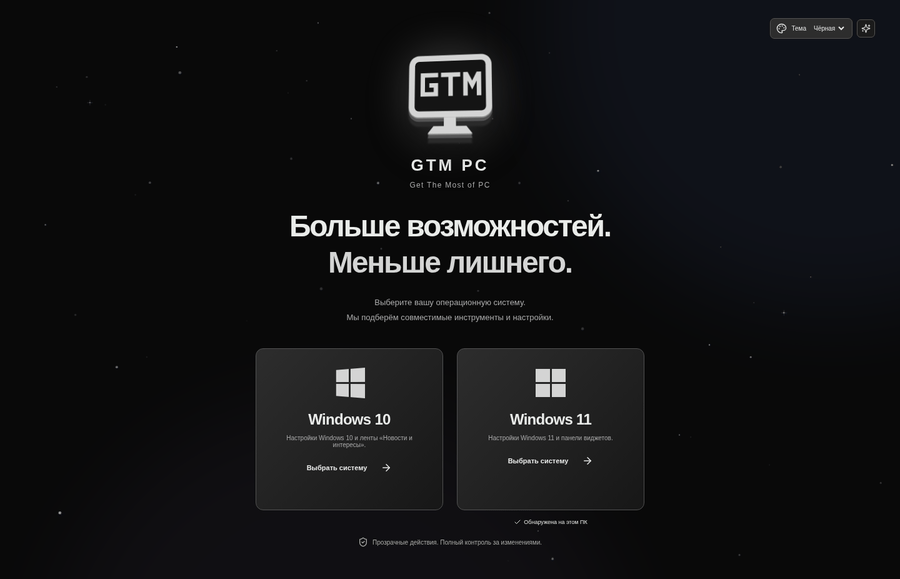
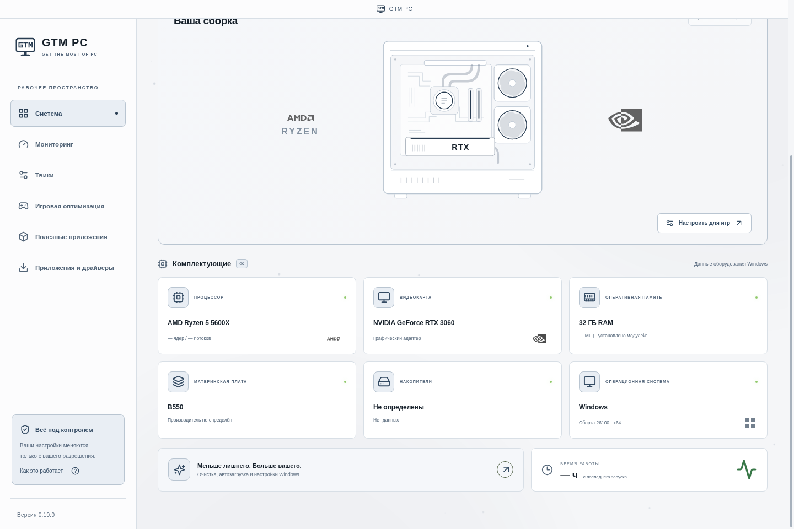

# GTM PC 0.10.0

<p align="center"><br/><strong>Get The Most of PC</strong></p>

Настольное приложение для Windows 10/11 x64: сведения о ПК и мониторинг оптимизации, автоматические профили настройки Windows с откатом, каталог приложений и официальная поддержка драйверов. React + TypeScript + Electron + Windows PowerShell 5.1.

## GTM PC 0.10.0 — две темы, новое окно и живой фон

**[⬇ Скачать GTM PC 0.10.0 — установщик Windows 10/11 x64](https://github.com/73skrxll-cmd/LAGOPHONE/releases/download/windows-37-1/GTM-PC-Setup-x64.exe)**

[Portable без установки](https://github.com/73skrxll-cmd/LAGOPHONE/releases/download/windows-37-1/GTM-PC-Portable-x64.exe) · [Релиз и контрольные суммы](https://github.com/73skrxll-cmd/LAGOPHONE/releases/tag/windows-37-1)

- **Только чёрная и белая темы.** Чёрная используется по умолчанию; старые цветные темы переходят на неё. Выбор белой темы сохраняется после перезапуска. Для светлого оформления адаптированы фон, текст, карточки, поля, предупреждения и игровые логотипы.
- **Место под нижними карточками:** пустой отступ с тонкой линией, без подписей.
- **Стилизованное окно:** верхняя панель в цвет темы и тонкая прокрутка с закруглённым ползунком. Кнопки сворачивания, разворачивания и закрытия остаются штатными Windows; панель поддерживает перетаскивание окна.
- **Светлый монитор GTM:** обновлены значки приложения, EXE, установщика и ярлыков.
- **Исправлен мониторинг:** эмблема ограничена по размеру и находится в центре индикатора, без растягивания и обрезания.
- **Живые звёздные обои:** три слоя звёзд плавно движутся с разной скоростью и мерцают. Фон работает независимо от анимаций Windows. Кнопка эффектов останавливает его; при потере фокуса или сворачивании окна движение приостанавливается.





Браузерные проверки охватывают обе темы, контраст текста, сохранение выбора, отступ, верхнюю панель, прокрутку, размер эмблемы, движение и остановку звёзд, а также прежнюю игровую анимацию. Windows-тесты и сборка пройдены. Готовый установщик скачан и проверен по SHA-256, версии, содержимому и новому значку внутри EXE.

Перед обновлением закройте прежнюю версию. После установки проверьте **GTM PC 0.10.0** внизу боковой панели. Выбранные игры, история и прежние настройки сохраняются.

## Скачать последнюю версию

### [⬇ Скачать последнюю версию GTM PC для Windows](https://github.com/73skrxll-cmd/LAGOPHONE/releases/latest)

**[Скачать установщик](https://github.com/73skrxll-cmd/LAGOPHONE/releases/latest/download/GTM-PC-Setup-x64.exe)** · **[Скачать Portable без установки](https://github.com/73skrxll-cmd/LAGOPHONE/releases/latest/download/GTM-PC-Portable-x64.exe)**

- **Установщик** — установка для текущего пользователя с ярлыками в меню «Пуск» и на рабочем столе. Удаление — через список приложений Windows.
- **Portable** — один EXE для запуска без установки; runtime распаковывается во временную папку.
- **SHA256SUMS.txt** в релизе — контрольные суммы обоих EXE.

**Node.js, npm и START-WINDOWS.cmd пользователю не нужны.** При применении или откате профиля Windows отдельно запросит права администратора (UAC). EXE пока без цифровой подписи.

Последняя успешно проверенная Windows-сборка из `main` автоматически появляется в разделе **Releases** справа на этой странице. Пока новая сборка выполняется или если она завершилась ошибкой, ссылки продолжают вести на предыдущий опубликованный релиз.

Резервный способ: [Actions → Build Windows application](https://github.com/73skrxll-cmd/LAGOPHONE/actions/workflows/windows-app.yml) → успешный запуск → **Artifacts → GTM-PC-Windows-x64**. ZIP-артефакты хранятся 30 дней; файлы Releases не имеют этого срока хранения. Повторная сборка и публикация: **Run workflow** на ветке `main`.

## Первый запуск и разделы приложения

Выбор Windows 10/11 сохраняется после первого запуска. При следующем открытии сразу появляется рабочее пространство. Сменить выбранную систему можно кнопкой Windows в верхней панели; проверка соответствия реальной ОС и сборке сохраняется.

В разделе **«Твики»** находятся системные профили, в отдельном разделе **«Игровая оптимизация»** — каталог игр, выбор EXE и собственная кнопка настройки CPU/GPU. Питание находится первым в «Твиках». Переход между разделами сохраняет текущий черновик. Игровая кнопка не применяет системный профиль: игры имеют отдельный журнал и не требуют отката системных твиков. Кнопка «Применить только питание» также использует отдельный журнал и быструю проверку питания без аудита служб и системных твиков. Смена системного профиля не включает план питания автоматически; план GTM PC Performance доступен независимо от системного профиля.

Проверенные установленные настройки отмечены **«Применено»** в активном сеансе или **«Уже настроено»**, если активного сеанса нет. Их галочки недоступны, повторно они не добавляются в черновик. После отката или внешнего изменения состояние обновляется при проверке. Поздравление после настоящей перезагрузки и проверки профиля сохраняется до нажатия «Открыть GTM PC», в том числе при повторном чтении состояния.

В мониторинге показываются фактические количества настроек, например 18/18 базовых, а не баллы 30/30. Вклад групп в итоговую шкалу описан отдельно.

## Поэтапное применение без обязательного отката

После базового профиля можно применить оставшиеся твики, другой профиль, игру или питание — предыдущие изменения сохранятся. Каждая новая порция системных твиков дополняет общий системный журнал; уже настроенные пункты пропускаются. При ошибке новой порции отменяется только она, а прежние успешно применённые настройки и их резервная копия сохраняются. Полное «Восстановить настройки» возвращает состояние до самого первого применения, включая последовательные переключения питания. Если операция была прервана или автоматическое восстановление не завершено, сначала требуется завершить восстановление — это отдельный аварийный случай.

## Самостоятельная игровая оптимизация

Логотип GTM PC → «Выбрать игру» → логотип выбранной игры → выбор основного EXE → своя кнопка «Оптимизировать». При нажатии белые частицы вылетают из кнопки и летят к центру логотипа, постепенно становятся золотистыми, формируют ореол и горизонт событий. После успешного применения вращение резко ускоряется, затем продолжается вокруг видимого логотипа. Только внешнее кольцо вращается в объёме, меняя видимый наклон; круговой горизонт и логотип неподвижны. Дальняя дуга скрыта за центром, ближняя проходит перед сферой и перекрывает логотип во время пролёта. Анимация работает независимо от настроек анимации Windows и фоновых эффектов приложения. При потере фокуса или скрытии раздела её таймер приостанавливается. Результат Windows отображается без искусственной задержки.

Каталог содержит 17 игр, включая Dota 2, CS2, PUBG, Deadlock, Fortnite, VALORANT, Apex Legends, GTA V, Rocket League, Rust и Cyberpunk 2077. «Другая игра» позволяет выбрать собственный EXE. Имена в каталоге не ограничивают имя выбранного файла. Настройка запрашивает высокий CPU-приоритет для точного запущенного процесса и сохраняет правило для имени EXE следующих запусков; GPU-предпочтение относится к выбранному пути. Приоритет реального времени не используется. Игры можно настраивать и повторно проверять независимо от системных твиков; кнопки обычного отката здесь нет. Питание применяется отдельной кнопкой в самом начале «Твиков».

Подготовка шейдеров и подключение SCSKiller удалены в 0.9.0. Игровая кнопка применяет только параметры CPU/GPU. Отдельно установленная программа и её кеши не удаляются.

Прирост FPS, изменение задержки и фризов нужно измерять в конкретной игре. [Исследование механизмов, источники и проверки](docs/game-optimization-research.md).

## Автоматические профили

В разделе **Твики**:

1. Выберите базовый, средний или глубокий профиль. Интерфейс сразу переводит к его составу: показывает размер списка, число отмеченных действий, сколько настроек добавлено или убрано и предлагаемый план питания. В базовом профиле нет строк старших уровней. Средний и глубокий уровни добавляют совместимые с выбранной Windows настройки; базовый набор, среднее и глубокое дополнения разделены на раскрываемые группы. При переключении раскрывается группа выбранного уровня. Питание находится первым в «Твиках», а EXE и приоритет — в самостоятельной «Игровой оптимизации».
2. Проверьте ответы: **«Использую — сохранить»** блокирует отключение функции; **«Не использую»** разрешает соответствующие твики. Рекомендации сохраняют печать/PDF, Bluetooth, запись игр, поиск и OneDrive; часть необязательных функций предложена к отключению только в старших профилях. Старые ответы при обновлении сохраняются. Кнопка **«Рекомендуемые ответы»** позволяет явно загрузить новые рекомендации.
3. При необходимости выберите план питания и игру. Для персональной настройки GPU укажите основной EXE игры через системный диалог.
4. В группах и категориях отметьте конкретные действия. Опрос сохраняемых функций и параметры питания/игры раскрываются отдельно; в базовом профиле опрос отключаемых функций скрыт. Цветная рамка, галочка и метка **«ВЫБРАНО»** означают включённый пункт; **«НЕ ВЫБРАНО»** — исключённый. Сохранённые/недоступные пункты остаются видны с причиной. Закреплённая плашка считает выбор в реальном времени, её стрелка ведёт к кнопке **«Оптимизировать»**. Подтвердите итоговый список и запрос Windows.
5. Прочитайте отчёт: применённые, пропущенные, восстановленные и ошибочные пункты отображаются отдельно. Кнопки **Восстановить исходные настройки** вверху раздела и **Восстановить настройки** на закреплённой плашке возвращают сохранённые значения.

Каждое открытие раздела начинается с **базового черновика**, текущего питания и без выбранной игры. Ответы о нужных функциях сохраняются. Сам выбор профиля ничего не запускает. У каждого твика отдельно показаны **«Даёт»** и **«Взамен»**; системные изменения, отключение функций и эксперименты выделены меткой **«ВАЖНО»**. Перед применением таких пунктов требуется прочитать последствия и отметить подтверждение в итоговом окне.

### Дополнительные настройки конфиденциальности и Проводника

В среднем и глубоком профилях доступны три новых пункта: отключение рекламного идентификатора Windows, скрытие недавних файлов и скрытие частых папок на главной странице Проводника. Все три **по умолчанию выключены**, не влияют на оценку профилей оптимизации и не обещают прироста FPS. Перед применением показаны последствия; может потребоваться перезагрузка для применения настроек. Файлы, история и закреплённые папки не удаляются.

Настройки применяются только к пользователю, запустившему приложение, на Windows 10 (сборка 10240+) и Windows 11. Версия и сборка проверяются в main process и PowerShell worker. Журнал сохраняет исходное наличие, тип и значение каждой записи. Откат восстанавливает их точно; при внешнем изменении не перезаписывает конфликтующее значение и оставляет журнал для повторной попытки.

Изучен [megapro17/Win-10-Tweakers](https://github.com/megapro17/Win-10-Tweakers/tree/46f7d301482aca18f56d005f94c21264947e33c6): это архив бинарных версий, а не исходников. Кандидаты выбраны по статическим строкам версии 7.0 (`AdvertisingInfo/Enabled`, `ShowRecent`, `ShowFrequent`) и реализованы независимо через штатный журнал GTM PC. Бинарные файлы не запускались и не включены в приложение.

### Состав

| Профиль | Изменения |
| --- | --- |
| Базовый · 18 | Игровой режим; анимации, прозрачность, тени и задержки интерфейса; задержка автозапуска оболочки; рекламные подсказки и рекомендации. Службы и рабочие функции Windows не отключаются. |
| Средний · Windows 10: 34, Windows 11: 33 | Базовый + фон Edge, автозапуск OneDrive/восстановление приложений, виджеты, веб-/облачный поиск, P2P-раздача обновлений, Aero Peek, запись игр и неиспользуемые службы. Функции с ответом «Использую» защищены от отключения. Три новые настройки конфиденциальности/Проводника выбираются вручную. |
| Глубокий · Windows 10: 42, Windows 11: 40 | Средний + индексация, офлайн-карты, медиасервер, удалённый реестр, история действий, MMCSS. SysMain и HAGS требуют отдельного внимания; часть экспериментальных пунктов по умолчанию не выбрана. |

В общем каталоге **46 действий**. На Windows 10: до 42 в уровнях + питание и три параметра EXE; на Windows 11: до 40 + те же отдельные параметры. Список и подписи формируются выбранной версией и фактической сборкой Windows, затем уточняются по наличию компонентов. Это размер каталога, не число гарантированно применённых изменений. Настройки, уже соответствующие цели, отсутствующие службы, неподдерживаемые сборки Windows и отсутствующие необязательные значения пропускаются с объяснением. При доступности всех пунктов рекомендации предлагают 18/26/31 действий на Windows 10 и 18/25/29 на Windows 11 соответственно без выбора EXE; на реальном ПК число может быть меньше. Выбор любого пункта можно отменить независимо. Ни количество записей реестра, ни название уровня не гарантируют прирост FPS; косметические настройки меняют интерфейс, а не вычислительную скорость.

Отключение ограничения мощности фоновых процессов удалено из новых профилей: для игрового ПК оно может увеличить конкуренцию фоновых задач за ресурсы. Сохранена поддержка **отката этого изменения из старой резервной копии**.

**SysMain** — отдельная экспериментальная опция только глубокого профиля, по умолчанию выключена и не запоминается. Отключение предварительной загрузки может ухудшить запуск приложений; это не универсальная оптимизация. Отключение Spooler затрагивает **Microsoft Print to PDF**, Bluetooth — беспроводные устройства, WSearch — индексируемый поиск и Outlook. Последствия каждого действия показаны до выполнения.

Планы питания: текущий, сбалансированный, штатные высокая/максимальная производительность, а также отдельный **GTM PC Performance** во всех профилях. Штатные планы переключаются только при наличии на ПК. Собственный план создаётся как отдельная копия текущего: на питании от сети min/max CPU = 100%, Boost = Aggressive, PCIe ASPM = 0. Это запрос состояния производительности, не 100% загрузка CPU и не разгон. Настройки батареи и исходная схема не редактируются. Возможны больший нагрев, шум и расход энергии; эффект зависит от CPU/прошивки. При откате восстанавливается прежний план и удаляется только созданная GTM PC копия. Существующий план с зарезервированным GUID не перезаписывается. Если копирование/настройка схемы запрещены платформой, пакет откатывается; выберите существующий план или «Оставить текущий».

Профили CS2, VALORANT, Fortnite, Dota 2 и Apex Legends показывают отдельный список последствий после выбора игры и её EXE. Есть два действия: **предпочтение производительного GPU** (`GpuPreference=2`) и необязательный эксперимент **без оптимизаций полного экрана** (`DISABLEDXMAXIMIZEDWINDOWEDMODE`). Второй пункт по умолчанию не выбран: может улучшить задержку или ухудшить FPS/переключение окон. Нужен перезапуск игры. Другие параметры GPU и флаги совместимости сохраняются. Без EXE персональные изменения не выполняются. Другие EXE не редактируются, но общие настройки Windows/питания влияют на весь ПК. Нет изменения файлов игры, приоритетов защищённых процессов, таймеров, CPU affinity или драйверов; античит не модифицируется.

### Выбранная Windows и реальная совместимость

Выбор ОС определяет **каталог, названия, опрос функций и число пунктов каждого профиля**. В Windows 10 пункт ленты управляет «Новостями и интересами» на панели задач; в Windows 11 тот же логический пункт использует другую политику панели виджетов. Timeline и предпросмотр рабочего стола Aero Peek предлагаются только Windows 10. Старые цели журнала сохраняются для точного отката.

Сборка дополнительно ограничивает наличие игровых и системных функций: игровой режим требует 15063+, предпочтение GPU для EXE — 17134+, HAGS и восстановление приложений при входе — 19041+, украшения поиска — 19044+. Отсутствующие службы и необязательные параметры не предлагаются к применению. Лента Windows 10 не создаётся искусственно, если её исходного параметра нет. В режиме предпросмотра другой ОС её каталог можно изучить, но применение блокируется.

Main process проверяет реальную Windows, сборку и доступность выбранных пунктов, независимо от интерфейса. Повышенный PowerShell-worker повторно сверяет ОС и границы поддержки целей; изменения сохраняются и проверяются после записи. Это реальное применение параметров, а не переключение декоративного профиля. Проверка прочитанного значения не является замером FPS или гарантией поведения каждой игры и драйвера; тесты на реальных выпусках Windows остаются необходимыми.

### Совместимость

Приложение не отключает Defender, Windows Update, Store, Gaming Services, Xbox Live, Secure Boot, TPM, VBS, FACEIT или Vanguard. Отключение Game DVR не удаляет Game Bar и Xbox: запись клипов станет недоступной, сама панель остаётся. Зависимые работающие службы не останавливаются каскадно, служба с активными зависимостями пропускается. Отсутствующие службы также пропускаются. Точные версии Windows сверяются перед применением.

Это ограничение области изменений, **не гарантия совместимости со всеми играми и античитами**. Производительность и совместимость необходимо проверять на реальном оборудовании. Отключение простаивающей службы может не дать измеримой экономии ресурсов.

### Резервная копия и отказоустойчивость

До первого изменения исходные значения сохраняются в `%ProgramData%\LAGOPHONE\optimization-state.json`. Каталог и сам файл журнала защищаются правами Administrators/SYSTEM, владельцем файла задаётся Administrators, обычным пользователям разрешено чтение. Это не даёт обычному владельцу процесса менять DACL журнала через право владельца. Сохраняются наличие, тип и значение реестра, режим запуска и состояние службы, отложенный автозапуск, исходный план питания. Изменения HKCU адресуются через **SID исходного пользователя в HKU**, в том числе при подтверждении UAC другой администраторской учётной записью.

Каждый результат проверяется после записи. При ошибке выполняется попытка отката всего сохранённого плана. При неполном восстановлении журнал сохраняет нерешённые пункты для повторной попытки. После аварийного завершения журнал обнаруживается при следующем запуске. Новый профиль нельзя применить поверх активного журнала. Конфликтующие значения реестра и планы питания, изменённые сторонними программами, не перезаписываются молча. Служба восстанавливается только из отключённого или исходного режима запуска.

Резервная копия параметров — **не точка восстановления Windows и не резервная копия файлов**. Пустые созданные разделы реестра могут остаться; исходные значения и их отсутствие восстанавливаются. Последний отчёт сохраняется в `last-optimization.json` внутри каталога пользовательских данных Electron. Не удаляйте журнал до отката. Пока идёт операция, закрытие окна и параллельные изменения из приложения блокируются.

Наличие старой копии показано отдельным сообщением вверху раздела. Она блокирует применение поверх неё, но **не блокирует просмотр и редактирование нового черновика**. Только живая операция держит блокировку элементов. Чтение состояния объединяет одновременные запросы, ограничено по времени и имеет явный повтор при ошибке; во время применения проверяется состояние операции в памяти без запуска нового PowerShell-аудита каждые две секунды. Проверка состояния сама не меняет Windows.

Очистка TEMP старше семи дней и ручные средства Windows доступны отдельно в **Дополнительных инструментах**. Очистка необратима и не входит в обратимый автоматический профиль.

## Перезагрузка после применения

После успешного применения **реальных изменений** приложение предлагает перезагрузить ПК сейчас или позже. Кнопка «Перезагрузить сейчас» вызывает отдельное подтверждение Windows-приложения; принудительное закрытие программ не используется. Отмена, ошибки и профиль без новых изменений не создают это предложение.

В готовой Windows-версии регистрируется разовый запуск для текущего пользователя в `HKCU\Software\Microsoft\Windows\CurrentVersion\RunOnce` (`GTM PCAfterRestart`). Он не требует новых прав администратора и не является постоянной автозагрузкой. Для portable используется путь исходного EXE, а не временная распакованная копия. До входа после перезагрузки не перемещайте portable EXE.

При следующем запуске сравнивается время загрузки Windows, проверяются активная резервная копия и фактические значения применённых пунктов. Поздравление показывается один раз после настоящей перезагрузки и успешной проверки. Простой повторный запуск приложения не считается перезагрузкой. При выходе из учётной записи без перезагрузки разовый запуск сохраняется до следующей загрузки, окно не открывается. Откат отменяет ожидающее поздравление. Это подтверждение настроек, не обещание прироста FPS.

## Мониторинг оптимизации

Раздел «Мониторинг» использует **профильную шкалу настройки GTM PC**. Базовые 18 параметров (игровой режим, оформление, запуск оболочки и рекомендации) дают максимум **30% — «Слабо»**. Поэтому и 13/18, и полный базовый профиль больше не отображаются как «Хорошо» или «Идеально».

Пять уровней: **плохо** — менее 20 баллов, **слабо** — 20–39, **средне** — 40–69, **хорошо** — 70–99, **идеально** — 100. Базовый набор даёт до 30 баллов, применимые рекомендуемые настройки среднего профиля — до 30, глубокого — до 30, проверенная настройка производительной GPU для EXE игры — 10. Без игрового профиля глубокий набор даёт максимум 90 — «Хорошо». «Идеально» требует полного совпадения доступной базы, среднего и глубокого наборов применённого глубокого профиля и действительного EXE игры с нужным GPU-предпочтением.

Сам выбор профиля/игры и снятие галочек не приносят баллов. Main process формирует план проверок из совместимых рекомендуемых пунктов и ответов пользователя; worker сохраняет его вместе с журналом. При проверке заново читаются все ожидаемые значения, включая настройки, которые уже были правильными до применения. Сохраняемые пользователем функции, недоступные пункты, SysMain, HAGS, MMCSS, полноэкранный эксперимент и личные настройки конфиденциальности/Проводника не обязательны для высшего уровня. Пустая или полностью недоступная группа не приносит баллов.

Откат убирает подтверждение применённого профиля. Внешнее изменение параметров или удаление EXE игры снижает уровень при следующей проверке. Старые журналы без плана проверок дают только базовые баллы. До получения полного базового набора и минимум 12 доступных проверок оценка не выставляется. Ошибка чтения, деморежим, текущая операция и незавершённое восстановление также не дают оценку. Чтение обновляется при открытии раздела, вручную и раз в 30 секунд, пока раздел видим; параллельные запросы объединяются. Главная, твики и мониторинг используют одну шкалу. Это проверка настроек выбранных профилей, а не измерение FPS, мощности ПК или гарантированного ускорения.

## Общие темы оформления

Фон охватывает **всё приложение**, включая выбор Windows, систему, мониторинг, твики, приложения и драйверы:

- **Чёрная:** звёзды с мягким мерцанием.
- **Фиолетовая:** неоновые линии, свечение и перспективная сетка.
- **Зелёная:** листья, ветви и контурные лотосы.
- **Синяя:** волны и воздушные пузырьки.
- **Красная:** тёплое свечение и медленные искры.

Декор расположен за интерфейсом, не перехватывает мышь и не перекрывает текст. Тема сохраняется локально. Кнопка со звёздочками рядом с выбором темы останавливает анимации фона и уровня оптимизации; рисунок остаётся видимым. Анимации останавливаются при скрытии/потере фокуса окна и учитывают системное уменьшение движения.

## Переходы между экранами

При выборе Windows экран плавно затухает за 140 мс, основной интерфейс появляется за 240 мс. Возврат к выбору ОС работает так же. Содержимое раздела появляется за 180 мс; только заголовок слегка смещается на 4 пикселя. Меню и общий фон сохраняются на месте. Обновление характеристик и проверок не запускает анимацию раздела повторно.

Используются CSS-прозрачность и небольшое смещение заголовка, без библиотек анимации, снимков экрана, размытия или постоянного JS-цикла. После завершения нет постоянного `will-change` или удерживаемого трансформированного слоя. При системном уменьшении движения остаётся только короткое затухание без смещения. Кнопка остановки эффектов отключает переходы полностью.

## Другие разделы

**Система:** CIM-информация о CPU, GPU, плате, ОЗУ, дисках, ОС и времени работы. Вместо рекламного баннера — векторный корпус с почти квадратными пропорциями, в цветах выбранной темы, с анимированными вентиляторами и мягкой подсветкой. По сторонам показаны логотипы обнаруженных производителей CPU, платы, GPU, памяти и накопителей. Неизвестные бренды не подставляются; производитель памяти читается из CIM. Нижняя строка с названием видеокарты убрана. В карточках комплектующих текстовые метки производителей заменены логотипами, а полные названия моделей сохранены. Надпись на видеокарте выбирается по обнаруженному GPU: RTX, GTX, Radeon, Intel Arc либо нейтральное обозначение при неизвестной модели. Корпус условный, не скан физической сборки. Анимация ставится на паузу кнопкой, при потере фокуса и скрытии окна; учитывается системное уменьшение движения. В браузере и на Linux явно показаны демоданные, системные операции не выполняются.

**Недавние действия:** колокольчик показывает фактические результаты применения и восстановления, подтверждённые смены питания и завершённые загрузки. До 80 записей сохраняются локально в `activity.json`; очистка списка не затрагивает резервную копию настроек. Ошибка записи истории не отменяет успешную системную операцию. Новый знак LG и подпись **«От игроков — для игроков»** используются в интерфейсе и иконках приложения; внизу боковой панели указана версия.

**Приложения:** Discord, NanaZip, qBittorrent, Steam, Mem Reduct, VS Code, Firefox, VLC. Прямое сохранение установщиков Discord, Steam, VS Code, Firefox; для остальных — официальный сайт. Установщики автоматически не запускаются. Mem Reduct нужен не всем ПК и не гарантирует ускорение.

**Драйверы:** семь активных карточек открывают окна: GPU, чипсет, LAN/Wi-Fi, звук, Bluetooth, накопители/NVMe/RAID и системные библиотеки. По обозначению платы предлагается конкретная страница AMD-чипсета, Intel-пакеты сети/Bluetooth — только при соответствующем обнаруженном адаптере; CPU сам по себе не считается доказательством Intel-сети. Для OEM доступны поиск точной модели и разделы поддержки. Есть стабильные прямые официальные установщики Intel DSA, VC++ x64/x86 и конкретные страницы пакетов. Для некоторых GPU требуется официальный селектор модели/ОС. Ревизия платы из WMI не считается надёжным определением физической ревизии. Неподтверждённые бинарные пакеты не подставляются, версии драйверов не сравниваются, автоматической установки нет. Доступность страниц производителя со временем может меняться.

## Разработка

Node.js **24 LTS**. На Windows из папки исходников:

```powershell
npm ci
npm run desktop
```

`START-WINDOWS.cmd` — вспомогательный запуск **для исходников**, требует Node.js. Не используйте его вместо готового EXE.

```sh
npm run dev          # браузерный интерфейс с демоданными
npm run build        # TypeScript + production Vite
npm test            # проверки политики и профилей, Windows-тесты на Windows
npm run dist:win -- --publish never
npm run dist:portable -- --publish never
```

В облачной Linux-среде для установки зависимостей через штатный прокси: `NODE_USE_ENV_PROXY=1 npm ci --no-audit --no-fund`. Сохраняйте proxy и CA-настройки, не отключайте TLS. NSIS-установщик на Linux требует Wine; предпочтительнее сборка в GitHub Actions на Windows. Worker `electron/optimizer.ps1` и его `registry-specs.json` распаковываются из ASAR отдельно для запуска Windows PowerShell. Узкий IPC не принимает произвольные команды и URL, профиль дополнительно проверяется в main process. `ExecutionPolicy Bypass` используется только для процесса нашего worker, системная политика выполнения скриптов не изменяется.

### Проверки

- JavaScript: несовпадение ОС, запрет неизвестных команд, опции профиля, сохранение используемых функций, opt-in SysMain, исключение защищённых служб, список HTTPS-адресов; отдельная блокировка живой операции, объединение чтений и повтор после ошибки, сохранение/очистка истории без удаления резервной копии, события по фактическим результатам и выбор надписи GPU.
- PowerShell: синтаксис worker; настоящий код восстановления с подменой только провайдеров проверяет отсутствие исходного значения, незавершённое применение, внешние конфликты, повторный откат, подменённый журнал, отложенный автозапуск, точный тип записи автозагрузки, применение и точный откат трёх дополнительных настроек (включая отсутствующие значения, исходный тип, конфликт и ошибку пакета), жизненный цикл собственной схемы питания, очистку неактивированной копии при ошибке и сохранение параметров игры. Этот тест выполнен в Linux на официальном PowerShell с проверенной SHA-256.
- Chromium: пять тем и их сохранение, профили, рекомендации отдельно для Windows 10/11, изменение счётчика, снятие всех галочек, стрелку/прокрутку к применению, последствия игрового профиля, окна драйверов, демоблокировку, узкий экран и обработку результата/откат с подставным native bridge. Подставной bridge не доказывает выполнение Windows-команд.
- Windows CI: PowerShell 5.1 и применение/точный откат пользовательских настроек реестра на одноразовом runner. Настоящие изменения выполняются **только** при `LAGOPHONE_WINDOWS_INTEGRATION=1`; не включайте этот флаг на повседневном ПК для запуска тестов.

Локально в Linux Windows-тесты явно пропускаются. Успешность конкретного Windows-run нужно проверять в Actions; локальная сборка не подтверждает её. Полная проверка отключения служб, UAC, обоих выпусков Windows 10/11 и совместимости с играми требует отдельных Windows-машин.

### Исправление 0.2.1

Исправлен запуск Windows PowerShell 5.1 из окружения PowerShell 7 (в том числе GitHub Actions через Node.js). Дочерний процесс получает штатные пути модулей Windows PowerShell, а не несовместимые пути PS7; родительское окружение и proxy/authentication не изменяются. Повышенный worker повторно задаёт штатный путь перед импортом модулей. Проверка ACL не удалена: тест загружает именно встроенный `Microsoft.PowerShell.Security`, находит `Set-Acl`, затем выполняет прежнюю проверку применения и точного отката реестра. Причина описана в [документации Microsoft](https://learn.microsoft.com/powershell/module/microsoft.powershell.core/about/about_psmodulepath#starting-windows-powershell-from-powershell-7).

Проверка загрузки модуля в Windows учитывает встроенные snap-in: путь `ModuleBase` не используется как единственный признак версии. Проверяются версия процесса Windows PowerShell, источник и сборка настоящего `Set-Acl`, а также применение исходного ACL к специально созданной временной папке с проверкой заданных прав и фактической записи/чтения файла. Тест применения и отката настроек Windows сохранён.

ACL-тест задаёт временной папке защищённую DACL с единственным явным FullControl текущего пользователя, проверяет SID, маску прав, флаги наследования и запись/чтение файла. Строковое равенство дескрипторов SDDL не считается равенством прав. Проверка применения и точного отката реестра остаётся обязательной.
